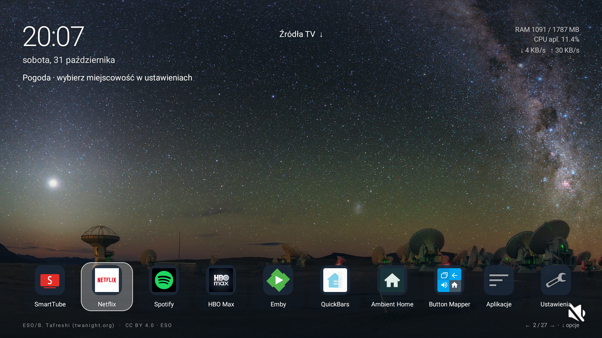
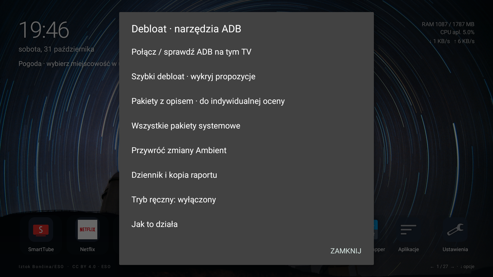
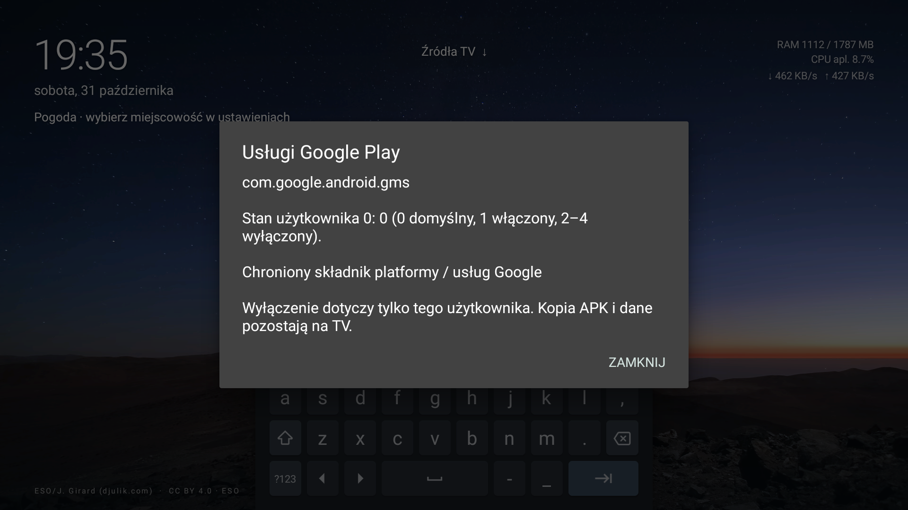

# Ambient Home Universal

**Lekki launcher Android TV / Google TV z astrofotografią i opcjonalnym Debloatem przez lokalne ADB.**

**0.5.1-beta1 · Android 8+ · Kotlin · MIT dla kodu**

[Polski](#polski) · [English](#english) · [Pobierz APK / Download APK](https://github.com/AdamGorniak/ambient-home/releases/tag/v0.5.1-beta1)

## Polski

### Ważne — używasz na własną odpowiedzialność

> **To eksperymentalna wersja beta. Instalujesz i testujesz APK oraz korzystasz z Debloatu na własną odpowiedzialność.** Wyłączenie pakietu systemowego może spowodować utratę funkcji, łączności, niestabilność, problemy z uruchamianiem lub utratę danych. Blokady ochronne i przywracanie **nie gwarantują bezpieczeństwa ani odzyskania każdej awarii**. Przed zmianami pobierz raport odzyskiwania i zachowaj działający dostęp ADB. Nie wyłączaj pakietów, których roli nie rozumiesz. Nie usuwaj danych ani nie odinstalowuj Ambient przed przywróceniem zmian lub zapisaniem zewnętrznej kopii raportu. Oprogramowanie jest udostępniane „tak jak jest”, bez gwarancji, zgodnie z [licencją MIT](LICENSE).

Ambient Home powstał z potrzeby spokojnego, szybkiego ekranu głównego: fotografia zamiast reklam, prosty dock, zegar i najważniejsze informacje. Wersja Universal oddziela launcher od opcjonalnych narzędzi systemowych — **sama instalacja nie wykonuje debloatu i nie zmienia automatycznie domyślnego HOME**.

### Co potrafi

- **28 fotografii offline, w tym 21 astro**: Droga Mleczna, gwiazdy i nocne obserwatoria. Zmiana co 5, 15, 30 lub 60 minut, codziennie albo stała tapeta. Domyślnie album nocnego nieba co 15 minut.
- Przewijany dock z nazwami pod ikonami, nieruchome przyciski Aplikacje/Ustawienia po prawej i automatyczne ukrywanie podczas bezczynności.
- Pełna nawigacja pilotem. Długie OK w docku uruchamia przesuwanie: lewo/prawo zmienia pozycję, OK zapisuje, Wstecz anuluje.
- Siatka wszystkich aplikacji, zmiana ich nazw i ukrywanie w docku bez odinstalowywania.
- Zegar, data, pogoda dla wybranej miejscowości oraz dyskretne statystyki pamięci, CPU i sieci. Bez domyślnej prywatnej lokalizacji autora.
- Źródła TV odczytywane z API urządzenia; własne nazwy i kolejność. Brak założenia, że każdy sprzęt ma takie same HDMI.
- Import własnych fotografii przez selektor dokumentów lub jawnie uruchamiany transfer LAN, gdy selektor producenta nie działa.
- **Debloat bez stale podłączonego PC**: lokalne ADB w APK, automatyczny dobór według profilu, jedno potwierdzenie, dziennik zmian, raport i przywracanie.

Interfejs APK jest obecnie po polsku. Dokumentacja dostępna jest również po angielsku poniżej.

### Zrzuty ekranu

Rzeczywiste obrazy z Xiaomi MiTV-MOOR2 / Android 11. Ekran główny pochodzi z uniwersalnego wariantu testowego 0.5 beta; screeny Debloatu pokazują wersję 0.5.0, sprzed przeniesienia ręcznych narzędzi do Zaawansowanych i dodania automatycznego doboru w 0.5.1. Odczyty statystyk na screenach dotyczą chwili wykonania zdjęcia.



| Debloat w ustawieniach | Chroniony pakiet systemowy |
|---|---|
|  |  |

Fotografie zachowują kredyty autorów widoczne na ekranie; zobacz [informacje o licencjach](THIRD-PARTY-NOTICES.md).

### Instalacja

1. Pobierz `AmbientHome-0.5.1-beta1-universal.apk` z [wydania beta](https://github.com/AdamGorniak/ambient-home/releases/tag/v0.5.1-beta1).
2. Opcjonalnie sprawdź SHA-256 pliku względem `SHA256SUMS.txt` z tego samego wydania.
3. Zainstaluj APK na Android TV / Google TV. Ustawienia zgody na instalację spoza sklepu zależą od urządzenia.
4. Otwórz Ambient, wybierz miejscowość pogody i skonfiguruj dock. Instalacja nie wymaga włączania Debloatu.
5. Jeżeli chcesz używać Ambient jako HOME, otwórz Ustawienia → Przycisk HOME → Wybór launchera HOME. Niektóre firmware blokują standardowy wybór; opcjonalny helper dostępności wymaga świadomej konfiguracji i osobnego testu.

To APK beta podpisane lokalnym kluczem deweloperskim projektu, nie wydanie sklepu Google Play. Nie zmieniaj podpisu ani nie usuwaj danych aplikacji po wykonaniu debloatu bez wcześniejszego przywrócenia zmian lub zachowania raportu. Zmiana klucza wydawcy może wymagać ponownej instalacji.

### Debloat prosto z APK

**Ustawienia → Debloat · narzędzia ADB → Szybkie czyszczenie · dobór automatyczny**

1. Włącz debugowanie i **klasyczne sieciowe ADB TCP** na TV, zwykle na porcie 5555.
2. Wybierz Połącz / sprawdź ADB i zaakceptuj klucz RSA Ambient na ekranie TV. Po pierwszej akceptacji może być potrzebne ponowienie sprawdzenia.
3. Uruchom Szybkie czyszczenie. Ambient sam dobierze pakiety zgodne z profilem urządzenia. Nie ma listy do zaznaczania. Nieznane modele, firmware i wersje pakietów są pomijane bez automatycznych zmian.
4. Możesz pobrać zewnętrzną kopię planu/raportu. Jedno potwierdzenie „Wyczyść” uruchamia dobrany plan.
5. W razie potrzeby użyj Przywróć zmiany Ambient dla jednej lub wszystkich własnych zmian.

APK komunikuje się z ADB na **tym samym TV**. Nie wymaga stale działającego komputera, Home Assistanta, Shizuku ani roota. **Jeśli firmware nie pozwala włączyć sieciowego ADB z menu, może być potrzebne jednorazowe przygotowanie przez komputer.** Parowanie TLS kodem/QR nowego Wireless debugging nie jest obsługiwane w tej wersji. Po restarcie niektóre TV ponownie wyłączają port ADB.

Debloat nie działa samoczynnie po instalacji, w tle ani przy każdym uruchomieniu. Wyłącza pakiety dla użytkownika aplikacji, bez usuwania APK, czyszczenia danych i resetu TV. Każdy początkowy stan jest zapisywany przed poleceniem. Błąd przerywa dalsze wykonywanie planu; wykonane wcześniej zmiany pozostają w dzienniku.

**Zakres automatu w 0.5.1:** jeden osobny pakiet analityki Xiaomi, na dokładnie wskazanym modelu, firmware i wersji pakietu. Profil oparto na audycie i obserwacji TV z pakietem już wyłączonym; nie na nowym teście wyłączenia/przywrócenia. Szczegóły i ograniczenia: [profile automatyczne](docs/AUTOMATIC-DEBLOAT.md). Brak zgodnego profilu oznacza brak automatycznych zmian, a nie prośbę o samodzielne rozpoznawanie pakietów. Ręczne narzędzia przeniesiono do **Zaawansowanych**; ich włączenie nie rozszerza automatu. Brak dodatkowych zmian nie oznacza braku całego bloatware.

### Ochrona i powrót

Chronione są m.in. launchery, setup/recovery, podstawowe usługi Google i platformy, aktywna dostępność (w tym QuickBars/Button Mapper), administratorzy, składniki sprzętowe i dostawcy wejść TV. Dodatkowe zależności OEM mogą nie być znane — ochrona jest ograniczeniem ryzyka, nie gwarancją.

Przywracanie obejmuje **tylko zmiany zapisane przez Ambient**. Nie włącza automatycznie pakietów wyłączonych wcześniej przez CleanMyTV, tvOS ani inne narzędzia. Zapisany stan `DEFAULT`/`ENABLED` jest odtwarzany odpowiednio przez `pm default-state`/`pm enable`, gdy pakiet nadal pozostaje wyłączony przez użytkownika. Zmiany wykonane poza narzędziem mogą wymagać indywidualnej oceny.

Raport JSON zawiera stany i polecenia odzyskiwania. Pobierasz go przez tymczasowy adres LAN z losowym tokenem; serwer zamyka się po zakończeniu okna lub opuszczeniu aplikacji. HTTP w lokalnej sieci nie jest szyfrowany. Klucz ADB nie trafia do raportu. Po utracie aplikacji zapisane polecenia można wykonać przez autoryzowane ADB na tym samym TV i użytkowniku. Brak działającego systemu lub sieci może uniemożliwić taki powrót.

### Zgodność i stan testów

| Obszar | Stan |
|---|---|
| Wymagania | Android TV / Google TV, Android 8+ / API 26; target SDK 35 |
| Sprzęt testowy | Xiaomi MiTV-MOOR2, Android 11 / API 30 |
| Testy automatyczne | 36 testów: ADB/RSA, blokady, dziennik, awarie i przywracanie, plan zbiorczy |
| Debloat na rzeczywistym TV | Lokalne ADB, skan, blokady GMS i eksport raportu; test **odczytowy**, bez wyłączeń systemowych |
| Rzeczywiste wyłączenia/przywracanie | Sprawdzone w kontrolowanych testach modelowych shell/journal; wymagają dalszych testów sprzętowych |
| Inne modele / restart / długi test | Brak potwierdzenia dla wszystkich firmware; mile widziane raporty zgodności |
| Samsung Tizen / LG webOS / Apple tvOS | Nieobsługiwane — to APK Androida |

HDMI i wybór HOME zależą od producenta. CPU całego TV może być niedostępny; wtedy widocznie oznaczany jest pomiar CPU aplikacji. RAM i sieć to odczyty całego urządzenia, a nie gwarantowany koszt samego launchera.

### Prywatność i licencje

Brak reklam i analityki aplikacji. Fotografie są lokalne. Po wyborze miejscowości pogoda korzysta z Open-Meteo/GeoNames przez HTTPS. Klucz ADB pozostaje w prywatnych danych aplikacji; automatyczny backup i transfer danych są wyłączone. Raport zawiera model/build, nazwy pakietów i skrót identyfikatora wiążącego dziennik z TV — sprawdź go przed publicznym udostępnieniem.

Kod: [MIT](LICENSE). Fotografie: osobne licencje ESO CC BY 4.0 i Unsplash, z autorstwem w [katalogu](app/src/main/assets/wallpapers.json). Narzędzia budowania i biblioteki zachowują własne licencje: [THIRD-PARTY-NOTICES.md](THIRD-PARTY-NOTICES.md). Obecność zdjęć ESO nie oznacza poparcia projektu przez ESO.

### Budowanie i zgłaszanie problemów

JDK 17, Android SDK 35, Build Tools 34.0.0. Ustaw lokalny SDK w `local.properties`, a następnie:

```sh
./gradlew assembleRelease lintRelease testDebugUnitTest
```

Na Windows użyj `gradlew.bat`. Wynik release jest niepodpisany; podpisz go własnym stabilnym kluczem przed dystrybucją. [Szczegóły techniczne po polsku](docs/TECHNICAL_PL.md).

Zgłoszenie powinno podawać model, wersję Androida, wersję APK i kroki odtworzenia. Nie publikuj kluczy ADB, tokenów, haseł, prywatnych raportów ani nieocenzurowanych logów z danymi osobistymi. Projekt rozwijany przy wsparciu AI; przegląd kodu i niezależne testy są szczególnie mile widziane.

---

## English

### Important — use at your own risk

> **This is experimental beta software. You install and test the APK and use its Debloat tools entirely at your own risk.** Disabling system packages may cause missing features, lost connectivity, instability, boot problems or data loss. Package protections and restore tools **do not guarantee safety or recovery from every failure**. Download a recovery report and keep working ADB access before making changes. Do not disable packages whose purpose you do not understand. Do not clear Ambient's data or uninstall it before restoring changes or saving an external recovery report. The software is provided “as is”, without warranty, under the [MIT license](LICENSE).

Ambient Home is a lightweight native Android TV / Google TV launcher built around photography, a simple dock and essential information. **Installing the APK does not automatically debloat the TV or change its default HOME.** The APK UI is currently Polish; this README is bilingual.

### Features

- **28 offline wallpapers, including 21 astrophotography images**: the Milky Way, stars and nighttime observatories. Rotate every 5/15/30/60 minutes, daily, or keep one image. The default is the night-sky album every 15 minutes.
- A scrolling app dock, fixed Apps/Settings shortcuts on the right, labels below icons and automatic idle hiding.
- Remote navigation and direct reordering: hold OK in the dock, move left/right, OK to save, Back to cancel.
- All-apps grid, local app renaming and dock hiding without uninstalling apps.
- Clock, date, user-selected weather and subtle device memory/network statistics; app CPU is clearly identified when device-wide CPU is unavailable.
- TV input discovery with editable local labels/order, without Xiaomi-specific HDMI IDs.
- Custom photo import through a document picker or an explicitly opened temporary LAN transfer when an OEM picker is unavailable.
- Optional **on-device ADB Debloat**, with profile-based automatic selection, one confirmation, a durable change journal, report export and restore.

[Real screenshots are shown above](#zrzuty-ekranu). They were captured on a Xiaomi MiTV-MOOR2 / Android 11; the images use the universal 0.5.0 test build, before 0.5.1 moved individual tools under Advanced and introduced automatic selection. Statistics are momentary readings, not performance guarantees. Photograph credits remain visible on screen.

### Install

1. Download `AmbientHome-0.5.1-beta1-universal.apk` from the [beta release](https://github.com/AdamGorniak/ambient-home/releases/tag/v0.5.1-beta1).
2. Optionally verify its SHA-256 against the release's `SHA256SUMS.txt`.
3. Sideload it on Android TV / Google TV, following your device's installer prompts.
4. Open Ambient, select your weather location and configure the dock. Debloat is optional.
5. To change HOME, use Settings → Home button → system HOME chooser. Some OEM firmware ignores the normal choice; the optional accessibility redirect requires explicit setup and device-specific testing.

This beta APK uses the project's local development signing key, not a Play Store release key. Preserve the recovery report and restore your changes before clearing app data, uninstalling, or migrating to a different signing key.

### On-device Debloat — no continuously connected PC

Open **Settings → Debloat → Quick cleanup / automatic selection** (Polish labels: `Debloat · narzędzia ADB` → `Szybkie czyszczenie · dobór automatyczny`).

1. Enable **classic network ADB TCP**, usually port 5555, in the TV's developer options.
2. Check the local ADB connection and approve Ambient's RSA key on the TV. Retry after the first approval if needed.
3. Run automatic Quick cleanup. Ambient selects packages matching the device profile; there is no package checklist. Unknown models, firmware builds and package versions are skipped without automatic changes.
4. Optionally download a recovery copy. One “Clean” confirmation executes the selected plan.
5. Restore one or all changes made by Ambient from the restore menu.

The APK connects to ADB on **the same TV**. It does not need a continuously running computer, Home Assistant, Shizuku or root. **A one-time PC setup may be necessary if your firmware cannot enable network ADB from its menus.** TLS code/QR pairing for newer Wireless debugging is not supported in this version. Some TVs close their ADB port after reboot.

There is no automatic background cleanup or boot-time debloat. Operations use `pm disable-user` for the app's user, keeping APKs and data. Each original state is persisted before the command. A failed batch stops subsequent operations; already completed changes remain journaled.

**Automatic scope in 0.5.1:** one standalone Xiaomi analytics package, restricted to an exact model, firmware fingerprint and package version. This profile is based on an audit and observation of a TV where the package was already disabled, not a fresh disable/restore test. See [automatic profiles](docs/AUTOMATIC-DEBLOAT.md). No matching profile means no automatic changes, without asking the user to identify packages. Individual tools are under **Advanced**; manual mode cannot expand automatic selection. No additional changes does not mean the TV has no bloatware.

### Protections and recovery

Protected categories include launchers, setup/recovery, core Google/platform components, active accessibility services such as QuickBars/Button Mapper, device administrators, hardware components and TV input providers. OEM dependencies may remain unknown. These protections reduce risk; they are not a safety guarantee.

Restore affects **only changes recorded by Ambient**. Packages disabled earlier by other tools are not automatically enabled. Original `DEFAULT`/`ENABLED` states use `pm default-state`/`pm enable` when the package remains user-disabled. External state changes may require individual review.

The recovery JSON includes original states and ADB recovery commands. Download it through an explicitly opened temporary LAN URL with a random token; closing the window or leaving the app shuts the server down. Local HTTP is unencrypted. The ADB private key is never included. If the app is lost, you can use the saved commands through authorized ADB on the same TV and user. A broken OS or lost network may prevent LAN recovery.

### Compatibility and validation

| Area | Status |
|---|---|
| Minimum | Android TV / Google TV, Android 8 / API 26; target SDK 35 |
| Hardware tested | Xiaomi MiTV-MOOR2, Android 11 / API 30 |
| Automated tests | 36 covering ADB/RSA, protections, journaling, failures, restore and batches |
| Real-device Debloat test | Local ADB, scans, GMS protection and report export; **read-only**, no system-package disable operations |
| Disable/restore operations | Validated against controlled shell/journal models; further hardware testing is needed |
| Other devices, reboot, long-term use | Not comprehensively validated; compatibility reports are welcome |
| Samsung Tizen, LG webOS, Apple tvOS | Not supported; this is an Android APK |

TV input switching and HOME behavior depend on OEM firmware. RAM/network statistics describe the device, and CPU may fall back to the app process. They are not fixed launcher resource budgets.

### Privacy, licenses and development

No app ads or analytics. Wallpapers are offline. Weather uses Open-Meteo/GeoNames over HTTPS after you select a location. ADB keys stay in private app storage; automatic backup/device transfer is disabled. Recovery reports contain model/build, package names and a hashed device-binding identifier: review them before sharing publicly.

Application code: [MIT](LICENSE). Photographs retain separate ESO CC BY 4.0 / Unsplash licenses and credits in the [asset catalog](app/src/main/assets/wallpapers.json). See [third-party notices](THIRD-PARTY-NOTICES.md). ESO imagery does not imply ESO endorsement.

Build with JDK 17, Android SDK 35 and Build Tools 34.0.0:

```sh
./gradlew assembleRelease lintRelease testDebugUnitTest
```

Use `gradlew.bat` on Windows. Configure your local SDK in `local.properties`. Release output is unsigned: sign it with your own stable publishing key. Build caches, signing/ADB keys, local journals and private reports do not belong in this repository.

When reporting an issue, include the TV model, Android version, APK version and reproduction steps. Never publish credentials, ADB keys, tokens or unredacted personal logs/reports. The project is developed with AI assistance; independent code review and device testing are welcome.
